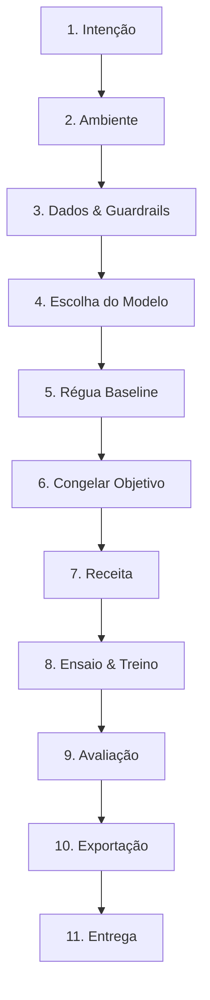

# QUANTUM PROTOCOL: THE 11-STAGE LLM HARNESS SPECIFICATION

> **Versão:** 1.0.0  
> **Papel do Agente:** Bibliotecário / Condutor Técnico do Processo (Harness Librarian)  
> **Filosofia:** Segurança em primeiro lugar, dados privados blindados, prevenção de OOM, reprodutibilidade estrita.

---

## 🛡️ Mandato Central de Privacidade (Guardrail Absoluto)

1. **PROIBIDO LER ARQUIVOS DE DADOS BRUTOS**: O agente de IA **NUNCA** deve usar ferramentas de leitura de arquivo (`view_file`, `cat`, etc.) para ler datasets brutos de treino (`.jsonl`, `.csv`, `.parquet`, `.txt`).
2. **APENAS ESTATÍSTICAS ANÔNIMAS**: Toda inspeção de dados de treino deve ser delegada ao comando local `quantum stage data-check` (ou módulo Python equivalente), que gera `.quantum/telemetry.json` contendo estritamente contagens, métricas de tokens, validação de schema e erros sintáticos — sem texto bruto nem PII.
3. **TRANSIÇÃO ESTRITA**: Nenhuma etapa pode ser pulada. A máquina de estados (`.quantum/state.json`) valida pré-requisitos antes de autorizar a etapa seguinte.

---

## 📋 A Máquina de Estados das 11 Etapas

---

### Etapa 1: Intenção (Entrevista Técnica)
- **Objetivo:** Estabelecer o propósito exato do modelo adaptado.
- **Perguntas-Chave:**
  - Qual a tarefa principal? (*Classificação*, *Extração Estruturada*, *Agente/Tool Calling*, *Raciocínio/RAG*, *Chat de Atendimento*)
  - Qual o domínio de negócio? (ex: Jurídico, Financeiro, Saúde, Suporte SaaS)
  - Qual o formato esperado de saída? (JSON schema estrito, Markdown, Texto livre)
  - Quais são os casos de borda e restrições de tom/segurança?
- **Comando:** `quantum stage intent --task <task> --domain <domain> --output-format <format> [--description <desc>]`
- **Artefato Gerado:** `.quantum/intent.json`
- **Portão de Saída:** Validação de que a intenção possui escopo bem definido.

---

### Etapa 2: Ambiente (Hardware & Infraestrutura)
- **Objetivo:** Detectar ou configurar o hardware disponível e calcular limites de VRAM.
- **Ações:**
  - Executa inspeção de hardware local via Python: PyTorch, CUDA, contagem de GPUs, modelo de GPU, VRAM total/livre, compute capability, memória RAM do sistema.
  - Se o treino for nuvem (Google Colab, RunPod, AWS EC2), perfila o alvo e define os parâmetros de tolerância.
  - Determina se o treinamento usará QLoRA (4-bit com NF4), LoRA (16-bit) ou Full Fine-Tuning.
- **Comando:** `quantum stage env [--target local|colab|runpod] [--vram-gb <gb>]`
- **Artefato Gerado:** `.quantum/environment.json`
- **Portão de Saída:** Verificação de suficiência de VRAM/RAM para o treino pretendido.

---

### Etapa 3: Dados & Guardrails (Sanitização e Validação)
- **Objetivo:** Auditar a integridade dos dados sem vazar segredos ou PII.
- **Ações:**
  - Valida o schema esperado: Alpaca (`instruction`, `input`, `output`), ChatML (`messages: [{role, content}]`), ShareGPT (`conversations: [{from, value}]`) ou Custom.
  - Verifica integridade UTF-8, campos nulos/vazios e duplicatas.
  - Calcula estatísticas locais de tokens (mínimo, máximo, média, p50, p95, p99) para definir o `max_seq_length` ideal.
  - Registra a telemetria anônima em `.quantum/telemetry.json`.
- **Comando:** `quantum stage data-check --dataset <path> [--val-dataset <path>] [--schema alpaca|chatml|sharegpt]`
- **Artefato Gerado:** `.quantum/telemetry.json`
- **Portão de Saída:** Zero erros críticos de schema; `max_seq_length` recomendado definido.

---

### Etapa 4: Escolha do Modelo Base
- **Objetivo:** Selecionar o foundation model ideal com base no cruzamento: (VRAM disponível × Contexto necessário × Tarefa).
- **Ações:**
  - Analisa a matriz de modelos suportados (Qwen 2.5 0.5B/1.5B/3B/7B/14B/32B, Llama 3.1 8B, Gemma 2 2B/9B, Phi-3.5 3.8B, SmolLM2, DeepSeek-R1-Distill-Qwen).
  - Cruza com o VRAM budget do ambiente (Etapa 2) e com o p99 de tokens (Etapa 3).
  - Define o modelo base e os templates de prompt adequados (ChatML, Llama-3, etc.).
- **Comando:** `quantum stage model-select [--model-id <id>]`
- **Artefato Gerado:** `.quantum/model_choice.json`
- **Portão de Saída:** Modelo escolhido compatível com o hardware detectado.

---

### Etapa 5: Régua (Baseline Zero-Shot)
- **Objetivo:** Estabelecer a pontuação de referência inicial antes de qualquer treino.
- **Ações:**
  - Cria ou carrega um conjunto de teste contendo de 10 a 20 casos representativos.
  - Executa o modelo base *zero-shot* nas amostras (via Ollama local, vLLM, transformers ou API).
  - Avalia métricas iniciais: taxa de JSON válido, conformidade de formato, acurácia semântica.
- **Comando:** `quantum stage baseline --eval-set <path> [--backend ollama|local|api|mock]`
- **Artefato Gerado:** `.quantum/baseline_results.json`
- **Portão de Saída:** Resultados baseline documentados e métricas iniciais gravadas.

---

### Etapa 6: Congelar Objetivo (Acceptance Criteria)
- **Objetivo:** Travar metas numéricas e critérios de sucesso imutáveis para evitar viés retrospectivo.
- **Ações:**
  - Define métricas mínimas requeridas (ex: `valid_json_rate >= 0.98`, `target_accuracy >= 0.90`, `max_hallucination_rate <= 0.02`).
  - O arquivo gerado é assinado com hash e marcado como imutável para a fase de avaliação.
- **Comando:** `quantum stage freeze-objective --min-accuracy <float> --min-json-rate <float> [--custom-metric <k=v>]`
- **Artefato Gerado:** `.quantum/benchmark_spec.json`
- **Portão de Saída:** Metas formalmente aceitas e congeladas.

---

### Etapa 7: Receita de Treinamento
- **Objetivo:** Gerar o script de treinamento LoRA/QLoRA otimizado e independente.
- **Ações:**
  - Configura hiperparâmetros com base nos dados e VRAM:
    - LoRA Rank ($r = 16 \text{ ou } 32$), $\alpha = 2r$, dropout $= 0.05$.
    - Target modules: `q_proj, k_proj, v_proj, o_proj, gate_proj, up_proj, down_proj`.
    - Learning rate: $2 \times 10^{-4}$ com scheduler linear ou cosine.
    - Gradient accumulation steps e batch size calculados para prevenir OOM.
    - Otimizador: `adamw_8bit` ou `paged_adamw_8bit`.
  - Gera `train.py` independente e `quantum_train_colab.ipynb` compatível com Unsloth ou Hugging Face TRL (`SFTTrainer`).
- **Comando:** `quantum stage recipe [--framework unsloth|trl] [--quantization 4bit|8bit|none] [--epochs <int>]`
- **Artefato Gerado:** `train.py`, `colab_train.ipynb`, `.quantum/recipe.json`
- **Portão de Saída:** Script e notebook sintaticamente válidos e prontos para teste.

---

### Etapa 8: Ensaio & Treinamento
- **Objetivo:** Garantir alocação estável de memória antes do treino real e orquestrar o processo.
- **Sub-etapa 8.1: Ensaio (Dry-Run)**:
  - Roda 2 a 5 batches de aquecimento.
  - Mede pico de VRAM, gradientes e tempo por step.
  - Se houver risco de OOM ou estouro de memória, sugere redução de batch size ou aumento de gradient accumulation.
- **Sub-etapa 8.2: Treinamento**:
  - Uma vez aprovado o ensaio, libera o treinamento completo.
  - Grava logs de perda (`train_loss`, `eval_loss`) e salva checkpoints dos adaptadores em `checkpoints/`.
- **Comandos:**
  - `quantum stage dry-run [--batches 3]`
  - `quantum stage train [--use-dry-run-check]`
- **Artefato Gerado:** `.quantum/dry_run.json`, `.quantum/training_log.json`, `checkpoints/`
- **Portão de Saída:** Treinamento finalizado sem falhas de OOM, adaptadores salvos.

---

### Etapa 9: Avaliação (Before vs After)
- **Objetivo:** Rodar a mesma régua da Etapa 5 no modelo treinado e checar critérios da Etapa 6.
- **Ações:**
  - Executa inferência com os adaptadores LoRA no mesmo conjunto de teste da Etapa 5.
  - Calcula o delta real de ganho (*gain analysis*):
    - Acurácia: Baseline vs Fine-Tuned.
    - Taxa de JSON Válido: Baseline vs Fine-Tuned.
    - Latência de inferência.
  - Compara os resultados finais com os critérios congelados na Etapa 6.
  - Gera relatório em Markdown com parecer: **APROVADO PARA PRODUÇÃO** ou **REQUER REVISÃO**.
- **Comando:** `quantum stage evaluate`
- **Artefato Gerado:** `.quantum/evaluation_report.json`, `evaluation_report.md`
- **Portão de Saída:** Critérios de aceitação atingidos (ou justificativa formal documentada).

---

### Etapa 10: Exportação (Merge & Quantização)
- **Objetivo:** Converter o adaptador treinado em artefatos otimizados de produção.
- **Ações:**
  - Faz o merge dos pesos LoRA com o modelo base (formato Safetensors FP16/BF16).
  - Executa ou gera receita de quantização GGUF para inferência ultra-rápida (Q4_K_M, Q5_K_M, Q8_0).
  - Registra hashes e tamanhos em disco.
- **Comando:** `quantum stage export [--format gguf|safetensors] [--quant q4_k_m|q8_0|fp16]`
- **Artefato Gerado:** `.quantum/export_spec.json`, arquivos em `export/`
- **Portão de Saída:** Artefato final gerado e verificado.

---

### Etapa 11: Entrega & Deploy
- **Objetivo:** Empacotar o modelo pronto para consumo por desenvolvedores e sistemas corporativos.
- **Ações:**
  - Gera arquivo de serviço `Modelfile` para carregamento imediato no Ollama (`ollama create meu-modelo -f Modelfile`).
  - Gera script de inicialização para servidores vLLM (`serve_vllm.sh`).
  - Gera servidor de teste rápido compatível com a API da OpenAI (FastAPI / `serve_api.py`).
  - Gera `HANDOVER.md` com guia completo de integração, exemplos de chamada cURL e Python, e limites operacionais.
- **Comando:** `quantum stage deliver [--target ollama|vllm|fastapi]`
- **Artefato Gerado:** `Modelfile`, `serve_vllm.sh`, `serve_api.py`, `HANDOVER.md`
- **Portão de Saída:** Projeto 100% finalizado e pronto para produção.
